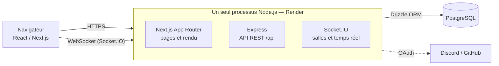
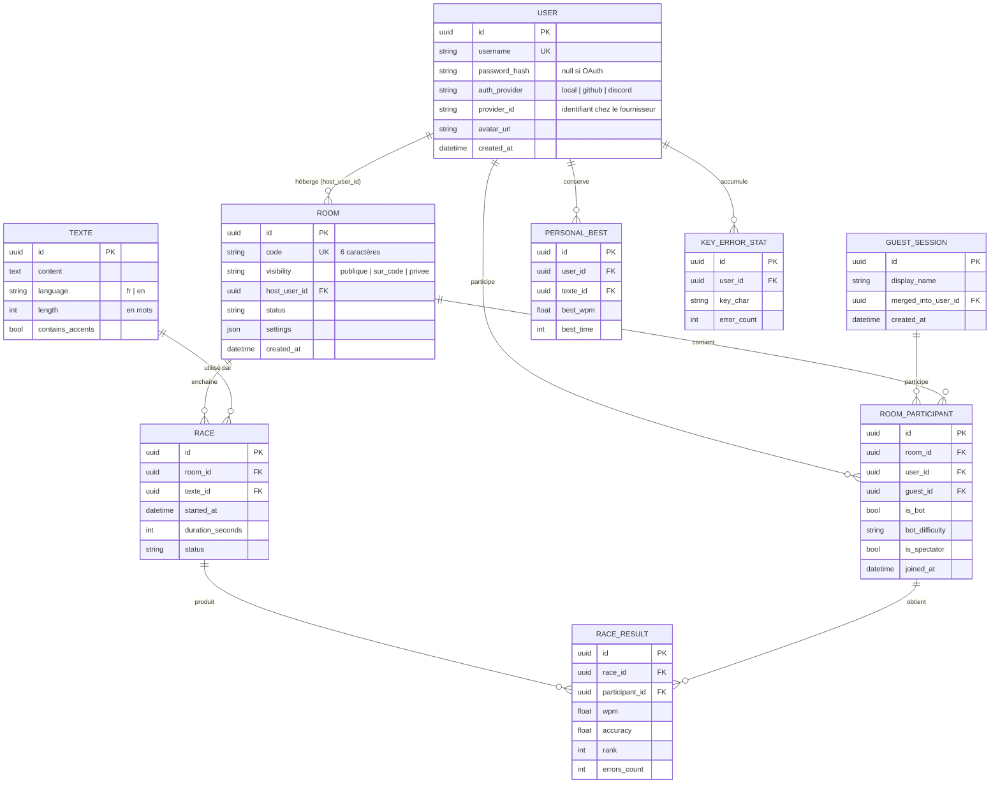
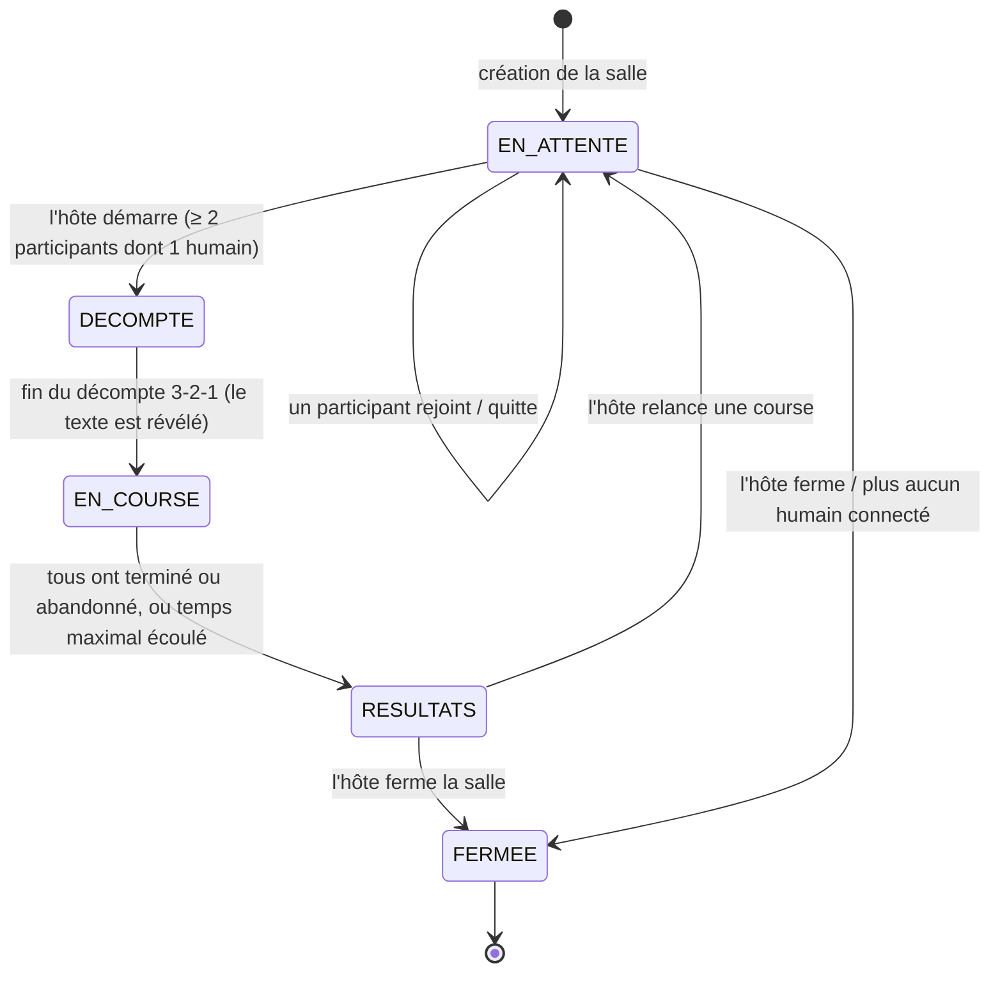
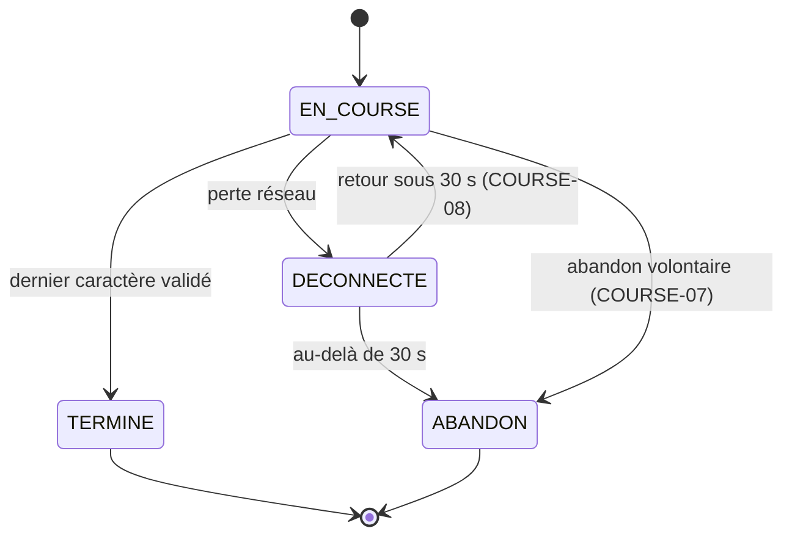

# Architecture — HotKB

Version de la **livraison finale** : tout ce qui est décrit ici est implémenté, sauf mention contraire. Le suivi exigence par exigence est dans [`EXIGENCES.md`](EXIGENCES.md).

## 1. Vue d'ensemble

- **Un seul processus** (`server/src/index.ts`) sert les pages Next.js, l'API REST et Socket.IO sur le même port et la même origine : pas de CORS en production, un seul service à déployer.
- **État de la salle en direct** : en mémoire (`server/src/rooms/manager.ts`, classe `RoomManager`), car il change à chaque événement. **Persistance** en base pour les salles, participants, courses et résultats. La logique pure (frappes, classement, bots, bonus, génération de texte) est isolée dans `server/src/race/`, sans entrée/sortie, ce qui la rend testable.
- **Authentification** : jeton JWT (30 jours) obtenu par compte local, invité ou OAuth ; il est aussi vérifié au *handshake* Socket.IO.
- **Validation** : tous les corps de requête et messages temps réel sont validés par des schémas Zod (`server/src/schemas.ts`).

## 2. Modèle de données

Source de vérité : migrations SQL versionnées (`server/migrations/`), reflétées en TypeScript par le schéma Drizzle (`server/src/schema.ts`).

Contrainte clé : un participant est **soit** un utilisateur, **soit** un invité, **soit** un bot (`CHECK one_identity`). La règle « une seule salle active par personne » (SALLE-06) est garantie par des **index uniques partiels** sur `room_participant` (où `left_at IS NULL`), donc même deux onglets ou deux requêtes simultanées ne peuvent pas créer de doublon.

Ajouts de la migration `003_course.sql` (par rapport au schéma ci-dessus) :

- `room_participant` : `bot_name`, `left_at`.
- `room_invite` : liens d'invitation (`token_hash` SHA-256, `used_by_*`, `used_ip`, `revoked`).
- `texte.complexity` (`easy | medium | hard`) ; `race.texte_id` devient facultatif et la course conserve `text_content`, `language` et `settings` (un texte aléatoire n'existe pas dans le corpus).
- `race_result` : `raw_wpm`, `time_ms`, `status`, `progress`, `bonuses`, `wpm_series`, `key_errors`, `personal_record`, avec unicité (course, participant).
- `user` : `avatar_data` (octets de la photo) et `avatar_updated_at` ; migration `004_profile.sql` : `display_name`.

Choix assumé : les tables `personal_best` et `key_error_stat`, créées à la migration 001, **ne sont pas utilisées** ; les records et les touches ratées se calculent à partir des résultats stockés (une seule source de vérité).

## 3. Machine à états d'une course (COURSE-01)

**Implémenté** : tous les états et transitions, dans `RoomManager` (`start`, `beginRace`, `endRace`, `rematch`, `backToLobby`, `close`). Le minimum de 2 coureurs (bots compris) et le rôle d'hôte sont vérifiés côté serveur.

Règles d'accès : on ne peut rejoindre qu'en `EN_ATTENTE` ou `RESULTATS`, jamais pendant `DECOMPTE`/`EN_COURSE` (SALLE-09).

État d'un participant pendant une course :

## 4. ADR-001 — Transport temps réel : WebSocket avec Socket.IO

- **Statut** : acceptée.
- **Contexte** : la piste de progression doit se mettre à jour en direct pour tous les participants (COURSE-05), avec un serveur autoritaire (COURSE-06), une tolérance à la déconnexion de 30 s (COURSE-08) et des diffusions d'événements de salle (arrivée d'un joueur, démarrage, bonus).
- **Options** :

| Option | Avantages | Limites pour ce projet |
|---|---|---|
| Polling HTTP | Très simple | Latence visible, charge inutile à haute fréquence |
| Server-Sent Events | Diffusion serveur→client native | Unidirectionnel : il faut un second canal pour envoyer les frappes |
| **WebSocket (Socket.IO)** | Bidirectionnel, faible latence, *rooms* intégrées, reconnexion automatique | Exige un serveur à processus persistant |
| MQTT | Léger, pub/sub | Broker supplémentaire à héberger gratuitement ; pas de notion de salle native |

- **Décision** : **Socket.IO**. Un *room* Socket.IO par salle de jeu, authentification par le même JWT que l'API, reconnexion gérée par la bibliothèque.
- **Conséquences** :
  - Le backend reste un **serveur à processus long** (pas de serverless) ; c'est pourquoi Next.js est servi par un **serveur personnalisé** qui héberge aussi Express et Socket.IO, plutôt que par un déploiement serverless de Next.js.
  - PERF-02 : les frappes sont **regroupées** par le client (un envoi toutes les 80 ms) et limitées à 15 messages/s par connexion côté serveur ; la piste est diffusée ≈ 5 fois par seconde, jamais écrites en base à chaque frappe ; seul le résultat final est persisté.
  - Pour passer à plusieurs instances, il faudrait un adaptateur Redis pour Socket.IO — hors périmètre.

## 5. Flux de messages temps réel

Toutes les entrées sont validées par Zod avant traitement (TECH-07). Les réponses (*acks*) valent `{ ok: true, state, youId }` ou `{ ok: false, error: <code> }` : le serveur n'envoie que des **codes** d'erreur, traduits côté client (I18N-01).

| Événement | Sens | Rôle |
|---|---|---|
| `room:create`, `room:join {code \| token}`, `room:quick`, `room:resume`, `room:leave` | client → serveur | Création (compte seulement), jonction par code ou lien, course rapide, reprise après reconnexion, sortie |
| `room:start`, `room:close`, `room:lobby`, `room:rematch` | client → serveur | Actions de l'hôte |
| `room:role`, `settings:update`, `bot:add`, `bot:remove`, `member:kick`, `invite:create`, `invite:revoke` | client → serveur | Rôle, réglages, bots, expulsion, invitations |
| `race:keys {keys}` | client → serveur | Rafale de caractères tapés (≤ 64) ; **jamais une position** |
| `race:abandon` | client → serveur | Abandon volontaire |
| `explorer:subscribe` / `explorer:unsubscribe` | client → serveur | Liste des salles publiques en direct |
| `room:state`, `room:invites` (hôte seul), `room:kicked`, `room:closed` | serveur → client | État public de la salle |
| `race:start` | serveur → client | Heure de départ (horloge serveur), texte (coureurs seulement), options |
| `race:tick` | serveur → salle | Positions, MPM, précision, brouillard de tous (≈ 5/s) |
| `race:text`, `race:bonus` | serveur → client | Texte modifié par un bonus ; annonce du bonus |
| `race:results` | serveur → salle | Classement final, courbes, touches ratées ; persisté en base |

Le **serveur est la source de vérité** (COURSE-06) : il fixe les temps de départ et de fin et **rejoue chaque frappe** contre le texte (`race/engine.ts`) ; l'excédent au-delà de 25 frappes/s (≈ 300 MPM) est rejeté. Le client ne fait que colorer les lettres en local pour une réponse immédiate ; sa position n'est jamais envoyée.

## 6. Bots (BOT-01 à BOT-05)

- **Exécution côté serveur**, dans le même processus : un moteur de simulation par course qui avance à pas fixe (200 ms), sans client réel. Un bot est un participant (`is_bot = true`) qui apparaît sur la piste comme les autres, clairement étiqueté (BOT-04).
- **Déterministe** (BOT-05) : le moteur reçoit une **graine** (`seed`) et utilise un générateur pseudo-aléatoire à graine (type *mulberry32*), jamais `Math.random()`. Même graine + même texte + même niveau ⇒ même course : testable unitairement.
- **Niveaux** (BOT-01) : MPM visé et taux d'erreur par niveau, ajustables et documentés :

| Niveau | MPM visé | Taux d'erreur |
|---|---|---|
| Noob | 10–20 | ~12 % |
| Débutant | 20–35 | ~8 % |
| Intermédiaire | 35–60 | ~5 % |
| Expert | 70–100 | ~2 % |
| Impossible | 140–170 | ~0,5 % |

- **Vitesse variable** (BOT-02) : le MPM instantané oscille autour de la cible (accélérations, hésitations) et ralentit sur les mots longs ou rares.
- **Erreurs** (BOT-03) : à chaque frappe, une erreur survient avec la probabilité du niveau ; elle coûte un temps de correction (mode « correction obligatoire ») ou est simplement comptée (mode « libre »), selon la configuration de la salle.
- **Bonus et malus** : les bots y sont soumis comme les humains (BOT-04).

Implémentation : `server/src/race/bots.ts` génère d'avance la **chronologie complète** d'un bot (`generateBotTimeline(seed, level, text, mode)`) à partir d'une graine ; la position à un instant donné se lit dans cette chronologie (`botStateAt`). Les bonus qui changent le texte d'un bot sont pris en compte par la même voie. Voir `server/test/race-bots.test.ts` (déterminisme, plages de MPM, taux d'erreur).

## 7. Génération du texte et bonus

- `race/text.ts` : le texte est soit un ou plusieurs **passages du corpus** (domaine public) de la langue choisie, soit des **mots tirés d'un dictionnaire**. Les options (ponctuation, chiffres, majuscules, accents, caractères inclus/exclus) sont appliquées mot par mot, et la typographie est normalisée (guillemets droits) pour rester tapable. La complexité d'un passage se calcule sur des critères mesurables : longueur moyenne des mots et part de caractères spéciaux.
- `race/bonus.ts` : quand le meneur atteint 25 %, 50 % et 75 % du texte, un coureur « en retard » (dernier, ou à plus de 25 points de progression derrière le meneur) reçoit un bonus de remontée : « −3 mots » pour lui, ou « +3 mots » / brouillard de 4 s pour le meneur ; au plus 3 par bénéficiaire ; l'annonce est diffusée à toute la salle (BONUS-03).
- Le tirage utilise une graine (`race/rng.ts`) : même graine, même texte et mêmes bonus, ce qui rend les tests reproductibles.
